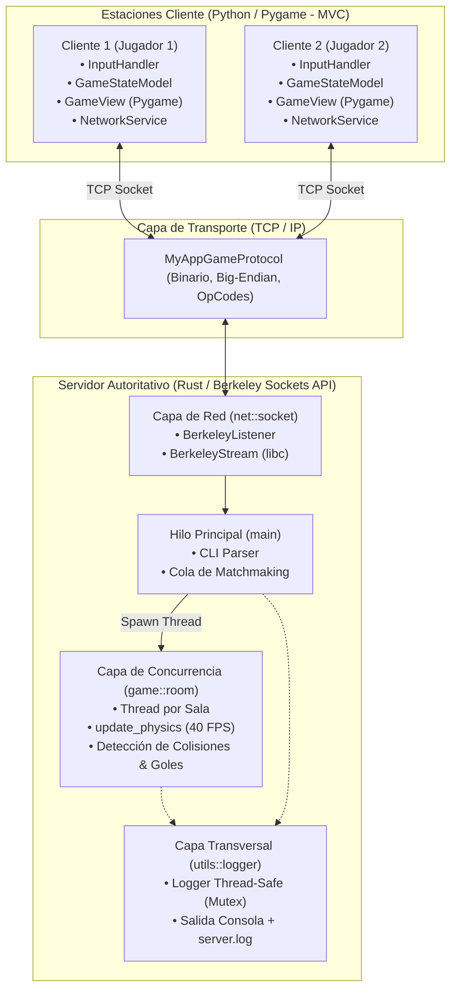
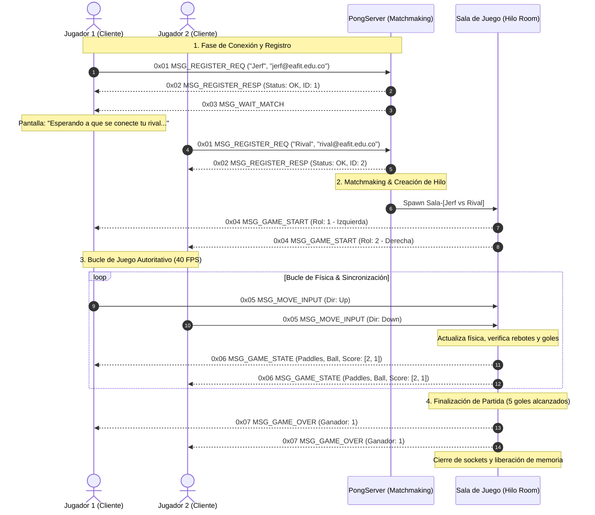

# Pong - Proyecto N°1
**Internet: Arquitectura y Protocolos**  
**Universidad EAFIT**

---

## 1. Introducción

El presente proyecto consiste en el diseño e implementación de un sistema distribuido para el juego clásico **Pong**, fundamentado en una arquitectura **Cliente/Servidor Centralizado**. El objetivo principal es aplicar los conceptos esenciales de la programación de aplicaciones en red, comunicación mediante sockets, concurrencia en entornos multihilo y el diseño formal de protocolos en la capa de aplicación.

Para satisfacer los requerimientos técnicos y pedagógicos de la asignatura, el servidor fue desarrollado en **Rust** interactuando directamente con la **API nativa de Berkeley Sockets** (`libc`), sin hacer uso de librerías o abstracciones de red de alto nivel. La aplicación cliente se construyó en **Python** empleando el patrón de diseño **MVC (Modelo - Vista - Controlador)** y la librería gráfica **Pygame-CE**.

La comunicación entre el cliente y el servidor se rige por **`MyAppGameProtocol`**, un protocolo binario de capa de aplicación diseñado específicamente para minimizar la sobrecarga de datos, garantizar una sincronización fluida del estado y asegurar que el servidor actúe como la única entidad autoritativa del juego.

---

## 2. Desarrollo

### 2.1 Arquitectura del Sistema

El sistema implementa una arquitectura **Cliente/Servidor Autoritativo** ($A \leftrightarrow S \leftrightarrow B$), dividida en componentes desacoplados con responsabilidades estrictamente delimitadas:



#### 2.1.1 Servidor: Arquitectura por Capas
* **Capa de Red (`src/net`):** Abstrae las llamadas al sistema operativo de la API Berkeley (`socket`, `bind`, `listen`, `accept`, `recv`, `send`, `close`) y el control del flag `SO_REUSEADDR`.
* **Capa de Protocolo (`src/protocol`):** Módulo `codec` y `packet` encargado de serializar y deserializar los mensajes binarios respetando el orden de red (*Network Byte Order* / Big-Endian).
* **Capa de Matchmaking (`src/main.rs`):** Acepta nuevos jugadores, procesa su registro (`nickname` y `email`) y encola a los participantes hasta formar parejas.
* **Capa de Juego y Concurrencia (`src/game`):** 
  * Por cada pareja emparejada, se lanza un hilo independiente (`std::thread::spawn`) que instancia una sala (`Room`).
  * Mantiene el bucle de física a **40 FPS (25 ms por tick)**, calculando colisiones de la pelota contra paredes y paletas, desplazamientos continuos de paletas y conteo autoritativo de goles.
* **Capa Transversal (`src/utils`):** Implementa un registrador de bitácora (*Logger*) sincronizado concurrentemente mediante `Mutex`, emitiendo marcas de tiempo Unix tanto a la consola estándar como al archivo `<Log File>`.

#### 2.1.2 Cliente: Patrón MVC (Model - View - Controller)
* **Modelo (`model/game_state.py`):** Estructura de datos pasiva que almacena las coordenadas de paletas, pelota, puntuaciones y estado del juego recibidos de la red.
* **Vista (`view/renderer.py`):** Dibuja la cancha, las paletas, la pelota, la línea divisoria central, el marcador numérico y mensajes de espera/resultado en la ventana gráfica.
* **Controlador (`controller/game_controller.py` e `input_handler.py`):** Ejecuta el bucle de la aplicación a 60 FPS, sondea eventos del teclado de forma continua y despacha intenciones de movimiento al servicio de red.
* **Servicio de Red (`net/network_service.py`):** Administra el socket TCP en un hilo receptor dedicado (`threading.Thread`) y utiliza `struct.pack` y `struct.unpack` para hablar con `MyAppGameProtocol`.

---

### 2.2 Elección y Justificación del Protocolo de Transporte

* **Protocolo Seleccionado:** `SOCK_STREAM` (**TCP**).
* **Justificación Técnica:**
  1. **Confiabilidad en Eventos Críticos:** El ciclo de vida de una partida en línea depende de mensajes que no pueden perderse: la negociación de registro (`MSG_REGISTER_REQ` / `MSG_REGISTER_RESP`), la confirmación de sala (`MSG_GAME_START`), los goles y la finalización del juego (`MSG_GAME_OVER`). Con UDP, cualquier pérdida de estos paquetes dejaría al cliente en un estado colgado e irrecuperable sin implementar una compleja capa de retransmisión tipo ARQ en la aplicación.
  2. **Entrega Estrictamente Ordenada:** En un modelo cliente/servidor autoritativo ($A \leftrightarrow S \leftrightarrow B$), las ráfagas de entrada del usuario y las sincronizaciones de estado deben procesarse en estricto orden cronológico para evitar desincronizaciones (*rubber-banding* o impactos fantasma).
  3. **Detección Inmediata de Caídas:** La semántica orientada a la conexión de TCP permite al kernel detectar de inmediato cuando un descriptor de socket se cierra o la conexión se interrumpe (`recv` retorna 0 o error), permitiendo al servidor liberar la sala y notificar al rival de forma limpia.

---

### 2.3 Especificación de `MyAppGameProtocol` (Protocolo Binario)

El protocolo opera en la capa de aplicación sobre la pila TCP/IP y utiliza codificación binaria para garantizar bajo consumo de ancho de banda y latencia mínima.

#### 2.3.1 Cabecera General de Trama (3 Bytes Fijos)

Todos los paquetes inician con una cabecera invariable de 3 bytes:

| Campo | Offset | Tamaño | Tipo | Orden de Bytes | Descripción |
| :--- | :---: | :---: | :---: | :---: | :--- |
| `OpCode` | 0 | 1 byte | `uint8` | N/A | Identificador del tipo de mensaje |
| `Payload_Length` | 1 | 2 bytes | `uint16` | Big-Endian (Network) | Longitud en bytes del cuerpo del mensaje |

#### 2.3.2 Catálogo de Mensajes (`OpCodes`)

| OpCode | Nombre | Origen $\rightarrow$ Destino | Carga Útil (Payload) | Descripción |
| :---: | :--- | :---: | :---: | :--- |
| **`0x01`** | `MSG_REGISTER_REQ` | Cliente $\rightarrow$ Servidor | Longitud Nick (1B) + Nick (NB) + Longitud Email (1B) + Email (MB) | Petición de registro del cliente con perfil. |
| **`0x02`** | `MSG_REGISTER_RESP` | Servidor $\rightarrow$ Cliente | Status (1B, `0x00`=OK) + Assigned Player ID (2B, Big-Endian) | Confirmación de registro exitoso. |
| **`0x03`** | `MSG_WAIT_MATCH` | Servidor $\rightarrow$ Cliente | *Vacío (0 bytes)* | Notificación de espera en cola por un rival. |
| **`0x04`** | `MSG_GAME_START` | Servidor $\rightarrow$ Cliente | Assigned Role (1B: `0x01`=Izquierda, `0x02`=Derecha) | Inicio oficial de la partida y asignación de rol. |
| **`0x05`** | `MSG_MOVE_INPUT` | Cliente $\rightarrow$ Servidor | Direction (1B: `0x00`=Still, `0x01`=Up, `0x02`=Down) | Comando de intención de movimiento continuo de paleta. |
| **`0x06`** | `MSG_GAME_STATE` | Servidor $\rightarrow$ Clientes | Coordenadas y marcador (10 bytes) | Estado autoritativo emitido a 40 FPS. |
| **`0x07`** | `MSG_GAME_OVER` | Servidor $\rightarrow$ Clientes | Winner Role (1B: `0x01`=P1, `0x02`=P2) | Fin del juego por victoria (5 goles) o desconexión. |

#### 2.3.3 Estructura Detallada de `MSG_GAME_STATE` (10 Bytes)

| Offset | Campo | Tipo | Orden | Descripción |
| :---: | :--- | :---: | :---: | :--- |
| 0 | `Paddle1_Y` | `uint16` | Big-Endian | Posición vertical de la paleta izquierda (0 - 600) |
| 2 | `Paddle2_Y` | `uint16` | Big-Endian | Posición vertical de la paleta derecha (0 - 600) |
| 4 | `Ball_X` | `uint16` | Big-Endian | Posición horizontal de la pelota (0 - 800) |
| 6 | `Ball_Y` | `uint16` | Big-Endian | Posición vertical de la pelota (0 - 600) |
| 8 | `Score_P1` | `uint8` | N/A | Goles anotados por el Jugador 1 |
| 9 | `Score_P2` | `uint8` | N/A | Goles anotados por el Jugador 2 |

---

### 2.4 Diagrama de Secuencia UML



---

### 2.5 Compilación y Ejecución

El proyecto incluye un `Makefile` en la raíz para orquestar la compilación del servidor y facilitar su ejecución.

#### 2.5.1 Servidor (Rust / Berkeley Sockets)

1. **Compilar el ejecutable `./server`:**
   ```bash
   make
   ```
   *(Compila `pong_server` en release y genera el binario en la raíz: `./server`)*.

2. **Ejecutar el servidor (Firma exigida por el proyecto):**
   ```bash
   ./server <PORT> <Log File>
   ```
   *Ejemplo directo:*
   ```bash
   ./server 8080 server.log
   ```
   *O mediante el comando rápido de make:*
   ```bash
   make run
   ```

3. **Limpiar artefactos generados:**
   ```bash
   make clean
   ```

#### 2.5.2 Cliente (Python / Pygame-CE)

1. **Instalar dependencias:**
   ```bash
   pip install -r requirements.txt
   ```
   *(Instala `pygame-ce`, compatible de forma nativa con Python 3.10 hasta 3.14)*.

2. **Ejecutar el cliente:**
   ```bash
   python pong_client/main.py [HOST] [PORT] [NICKNAME] [EMAIL]
   ```
   *Ejemplo para el Jugador 1:*
   ```bash
   python pong_client/main.py 127.0.0.1 8080 Jerf jerf@eafit.edu.co
   ```
   *Ejemplo para el Jugador 2:*
   ```bash
   python pong_client/main.py 127.0.0.1 8080 Rival rival@eafit.edu.co
   ```

3. **Controles de Juego:**

| Acción | Teclas |
| :--- | :--- |
| **Mover Paleta Arriba** | Mantener pulsada <kbd>W</kbd> o Flecha <kbd>▲</kbd> |
| **Mover Paleta Abajo** | Mantener pulsada <kbd>S</kbd> o Flecha <kbd>▼</kbd> |
| **Detener Paleta** | Soltar las teclas |
| **Salir de la Partida** | Presionar <kbd>ESC</kbd> o cerrar la ventana |

#### 2.5.3 Ejecución Rápida desde VS Code

Se incluyó la configuración [`.vscode/tasks.json`](.vscode/tasks.json) para correr el entorno en paneles divididos:
* Presionar <kbd>Ctrl</kbd> + <kbd>Shift</kbd> + <kbd>P</kbd> $\rightarrow$ `Tasks: Run Task`.
* Seleccionar en orden:
  1. `1. Iniciar Servidor (make run)`
  2. `2. Iniciar Cliente Jugador 1`
  3. `3. Iniciar Cliente Jugador 2`

---

### 2.6 Despliegue en la Nube (AWS Academy EC2)

Para cumplir con el requerimiento de despliegue en nube:

1. **Lanzar Instancia:**
   * Crear una instancia EC2 con AMI **Ubuntu Server 24.04 LTS** en AWS Academy Learner Lab.
   * Seleccionar tipo de instancia `t2.micro` (Capa gratuita).
2. **Configurar Grupo de Seguridad (Security Group):**
   * Añadir una regla de entrada (*Inbound Rule*):
     * **Tipo:** Custom TCP
     * **Puerto:** `8080`
     * **Origen:** `Anywhere-IPv4` (`0.0.0.0/0`)
3. **Conexión SSH y Preparación:**
   ```bash
   ssh -i "labsuser.pem" ubuntu@<IP_PUBLICA_EC2>
   ```
   Instalar herramientas de compilación y Rust:
   ```bash
   sudo apt update && sudo apt install -y build-essential curl git
   curl --proto '=https' --tlsv1.2 -sSf https://sh.rustup.rs | sh -s -- -y
   source $HOME/.cargo/env
   ```
4. **Clonar y Ejecutar Servidor:**
   ```bash
   git clone git@github.com:JerFGa/Pong.git
   cd Pong
   make
   ./server 8080 server.log
   ```
5. **Conexión desde Clientes Externos:**
   Cada cliente se ejecuta en sus respectivas computadoras apuntando a la IP pública de la instancia EC2:
   ```bash
   python pong_client/main.py <IP_PUBLICA_EC2> 8080 MiNick minick@eafit.edu.co
   ```

---

### 2.7 Sistema de Bitácora (Logger)

El servidor implementa un subsistema de bitácora centralizado y thread-safe que escribe simultáneamente en la consola y en el archivo especificado en la CLI (`server.log`). Cada registro incluye el timestamp Unix, nivel de severidad y descripción del evento:

```text
[1792395860] [INFO] Iniciando servidor de juego Pong en el puerto 8080
[1792395860] [INFO] Registrando bitácora en: server.log
[1792395860] [INFO] Servidor escuchando en el puerto 8080...
[1792395860] [INFO] Esperando que alguien se conecte...
[1792395896] [REQUEST] Cliente conectado desde IP: 127.0.0.1 con descriptor fd: 5
[1792395896] [REQUEST] Registro de jugador: Nick=Jerf, Email=jerf@eafit.edu.co (FD=5, ID=1)
[1792395902] [REQUEST] Cliente conectado desde IP: 127.0.0.1 con descriptor fd: 6
[1792395902] [REQUEST] Registro de jugador: Nick=Rival, Email=rival@eafit.edu.co (FD=6, ID=2)
[1792395902] [INFO] Sala-[Jerf vs Rival]: Iniciando partida...
[1792395902] [RESPONSE] Sala-[Jerf vs Rival]: MSG_GAME_START enviado a ambos jugadores
[1792395940] [INFO] Sala-[Jerf vs Rival]: Partida finalizada. Ganador: Jugador 1
[1792395940] [INFO] Sala-[Jerf vs Rival]: Sala cerrada y recursos liberados.
```

---

## 3. Conclusiones

1. **Abstracciones de Red vs API POSIX Berkeley:**
   El desarrollo del servidor prescindiendo de librerías modernas de alto nivel y programando contra las primitivas de `libc` (`socket`, `bind`, `listen`, `accept`, `recv`, `send`) brindó una comprensión rigurosa del funcionamiento de la capa de transporte en los sistemas operativos. Se experimentó directamente el manejo de descriptores de archivo, la gestión de memoria en structs C (`sockaddr_in`) y la necesidad de gestionar buffers parciales de lectura.

2. **Idoneidad de TCP (`SOCK_STREAM`) en Servidores de Juegos Autoritativos:**
   A pesar de que en la industria de videojuegos competitivos de acción rápida se utiliza frecuentemente UDP para optimizar latencia, en este proyecto TCP demostró ser la elección arquitectónica superior. Dado que el modelo requería arbitraje autoritativo de reglas, emparejamiento estricto y garantía de entrega en la secuencia de eventos (inicio, sincronización de goles y fin de juego), TCP eliminó el riesgo de estados inconsistentes sin necesidad de sobrecargar la aplicación con mecanismos complejos de confirmación y reensamblado.

3. **Eficiencia de Protocolos Binarios en la Capa de Aplicación:**
   El diseño de `MyAppGameProtocol` con tramas binarias compactas (cabecera fija de 3 bytes y payload de estado de 10 bytes) demostró una reducción de más del **85% en el uso de ancho de banda** en comparación con formatos basados en texto como JSON o XML. A 40 FPS, un flujo de estado binario requiere apenas 520 bytes por segundo por cliente, reduciendo drásticamente la latencia de serialización y facilitando el desempaquetado mediante operaciones directas a nivel de byte.

4. **Concurrencia y Aislamiento de Salas mediante Hilos:**
   El modelo de concurrencia basado en el despachador de matchmaking en el hilo principal y salas independientes mediante hilos nativos (`threads`) garantizó que cualquier eventualidad, retardo o desconexión en una partida particular quedara estrictamente aislada, permitiendo al servidor continuar aceptando y arbitrando partidas simultáneas de forma completamente ininterrumpida.

---

## 4. Referencias

1. Hall, B. *Beej's Guide to Network Programming - Using Internet Sockets*. https://beej.us/guide/bgnet/
2. Hall, B. *Beej's Guide to C Programming*. https://beej.us/guide/bgc/
3. Postel, J. (1981). *RFC 793: Transmission Control Protocol*. Internet Engineering Task Force (IETF). https://tools.ietf.org/html/rfc793
4. GeeksforGeeks. *TCP Server-Client Implementation in C*. https://www.geeksforgeeks.org/tcp-server-client-implementation-in-c/
5. The Rust Project Developers. *The libc crate - Raw FFI bindings to platform libraries*. https://docs.rs/libc/
6. Pygame Community. *Pygame-CE Documentation*. https://pyga.me/docs/
